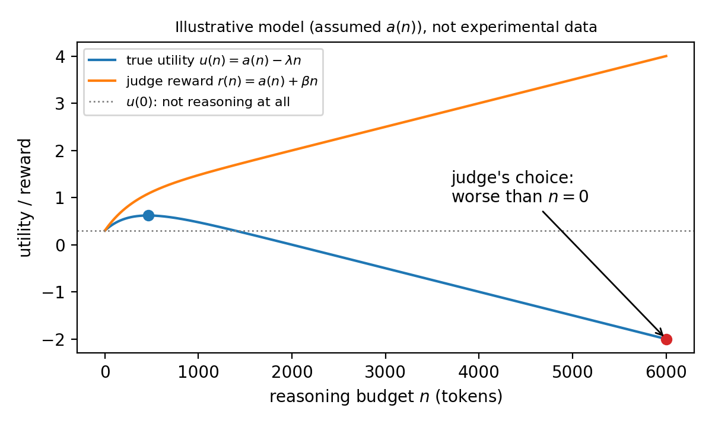

# When Is Reasoning Worth the Tokens?

### A Pigeonhole Bound on Worthwhile Reasoning, and Why a Length-Biased Judge Cannot Ignore It

**Author:** Riccardo Galmozzi  
**Paper:** [paper.pdf](paper.pdf)

---

## Overview

This repository contains the official experiment kit and theoretical simulation code for the paper *"When Is Reasoning Worth the Tokens? A Pigeonhole Bound on Worthwhile Reasoning, and Why a Length-Biased Judge Cannot Ignore It"*.

As chain-of-thought and test-time compute become central to language model scaling, text generation length is frequently treated as a proxy for reasoning effort. This work analyzes the fundamental economic and evaluation limits of test-time reasoning:

1. **Proposition 1 (Pigeonhole bound on worthwhile reasoning):**  
   Because accuracy is capped at $1$ ($a(n) \le 1$), for any fixed accuracy-equivalent cost per block $c > 0$, at most $\lfloor 1/c \rfloor$ reasoning blocks can each add at least $c$ accuracy. This holds universally for any model and benchmark, regardless of architecture or scaling.
2. **Proposition 2 (Goodhart risk under length-biased evaluation):**  
   If an evaluator or LLM judge has any positive per-token length bias ($\beta > 0$), optimizing for judge preference under a sufficiently large budget cap will eventually select an operating point with lower true net utility than **not reasoning at all** ($n = 0$).

> **Important scope:** The pigeonhole bound constrains *how much* reasoning can be worth buying, not *where* profitable blocks occur. Non-concave accuracy curves (e.g., plateaus followed by sudden jumps) can violate naive greedy stopping rules ("stop at the first unprofitable block"). The experiment kit evaluates this prefix hypothesis empirically.

---

## Theoretical Illustration (Proposition 2)



> **Note:** The plot above illustrates Proposition 2 under an assumed analytical accuracy curve $a(n) = a_0 + (1 - a_0)(1 - e^{-n/\tau})$. It is an illustrative theoretical model, not experimental data.

---

## Repository Structure

```text
├── paper.pdf               # Full paper PDF
├── run_experiment.py       # Truncate-and-answer experiment on GSM8K using vLLM
├── judge.py                # Pairwise LLM-judge win rate evaluation (Hypothesis 1(b))
├── analyze.py              # Bootstrap CIs, hypothesis testing, and figure generation
├── make_theory_figure.py   # Script generating theory_figure.png / theory_figure.pdf
├── theory_figure.png       # Illustrative figure for Proposition 2
├── LICENSE                 # MIT License
└── README.md               # Repository documentation
```

---

## Quickstart & Installation

GPU is required only for generation in Step 1. A modest open-weights model (e.g. `Qwen/Qwen2.5-Math-1.5B-Instruct`) running on a single GPU is sufficient.

```bash
pip install vllm datasets openai pandas numpy matplotlib
```

---

## Reproduction Pipeline

### Step 1: Run Truncate-and-Answer Experiment
Generates step-by-step reasoning traces and evaluates forced boxed answers across budget cutoffs $n \in \{0, 64, 128, \dots, 1024\}$:

```bash
python run_experiment.py --model Qwen/Qwen2.5-Math-1.5B-Instruct --tasks 500 --seeds 3
```

- Produces `results.csv` (`task_id, seed, n, correct`)
- Produces `responses.jsonl` (full prompts and responses at each budget $n$)

### Step 2: Run Pairwise LLM-Judge Evaluation *(Optional)*
Tests whether an external LLM judge favors longer responses over $n=0$ even when accuracy gains diminish (Hypothesis 1(b)):

```bash
# Set your OpenAI API key or compatible endpoint
export OPENAI_API_KEY="your-api-key"

python judge.py --judge-model gpt-4o-mini
```

- Produces `judge.csv` (`task_id, seed, n, win`)

### Step 3: Statistical Analysis & Hypothesis Testing
Computes the empirical accuracy curve $a(n)$, cumulative maximum $\bar{a}(n)$, bootstrap confidence intervals (resampling tasks), and tests Hypothesis 1(a):

```bash
python analyze.py --lam 0.01
```

> **Methodological Note:** Choose `--lam` (accuracy cost per 64-token block) **before** inspecting empirical results to avoid confirmation bias.

- Generates `figure.png` and `figure.pdf` (Accuracy vs. budget, and judge win-rate vs. budget).

### Step 4: Generate Proposition 2 Theory Figure
To reproduce the theoretical illustration:

```bash
python make_theory_figure.py
```

---

## Citation

If you build upon this work or use this experiment kit, please cite:

```bibtex
@article{galmozzi2026pigeonhole,
  title   = {When Is Reasoning Worth the Tokens? A Pigeonhole Bound on Worthwhile Reasoning, and Why a Length-Biased Judge Cannot Ignore It},
  author  = {Galmozzi, Riccardo},
  year    = {2026}
}
```

---

## License

This project is licensed under the [MIT License](LICENSE).
